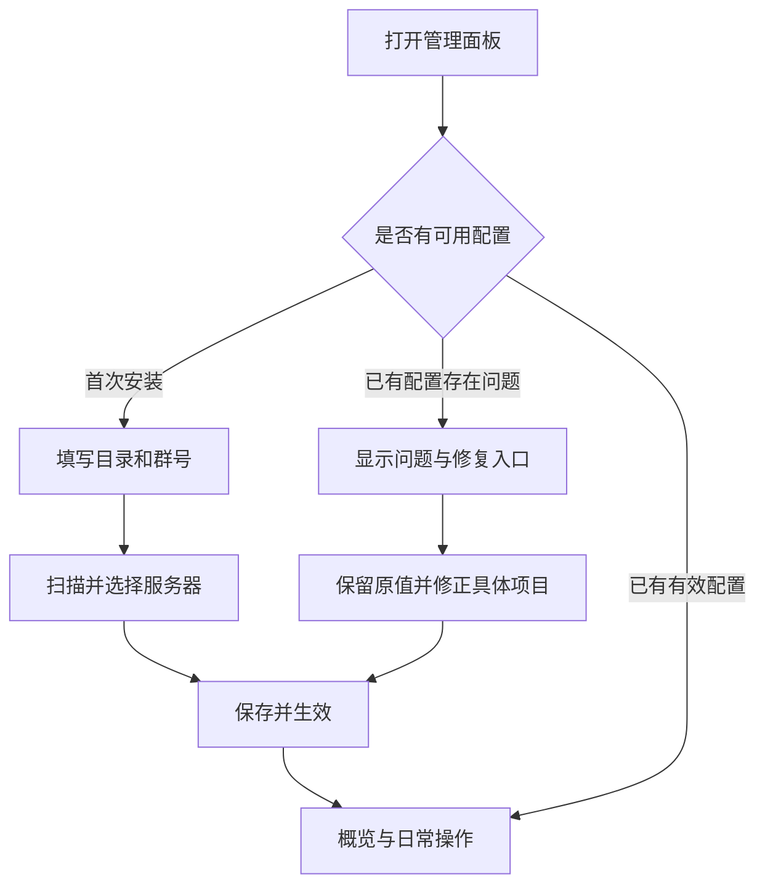

# 操作简化与历史配置兼容性调研

调研日期：2026-10-19。对象：当前工作区（含尚未发布的改动）和本地 v1.0.0 至 v1.5.0 的 14 个历史标签。本文是设计建议，不表示建议中的功能已经实现。

## 结论

可以继续简化，而且目标可以设为：新用户填写服务端目录和群号即可完成常见配置，老用户沿用已有配置直接进入概览。前提是把界面简化、配置迁移和历史恢复分开处理。隐藏高级选项不应删除其存储值，也不应让已有用户的指令、权限和回复方式随默认值变化。

当前快速配置已经提供了这条新用户路径，不需要另造一套向导。优先补足历史配置的保存与迁移，再收敛页面入口。

## 1. 当前已经具备的基础

| 内容 | 当前行为 | 后续方向 |
| --- | --- | --- |
| 快速配置 | 扫描 `server.properties`，读取 RCON、正版模式等，选择服务器并绑定群聊，一次保存 | 配置完整时直接进入概览 |
| 手动配置 | 远程地址、容器映射等特殊情况可手动填写 | 默认折叠，遇到特殊情况再展开 |
| 日常操作 | 概览可进入连接修复；白名单已有查询和管理入口 | 在服务器卡片中显示状态与下一步操作 |
| 共享服务器 | 多群与服务器支持多对多绑定，另行校验归属和权限 | 沿用绑定，新增群不重分配历史归属 |
| 配置保存 | 已有校验、并发修订标识、原子写入和失败回滚 | 在同一流程加入历史快照和迁移校验 |
| 备份 | 已有配置与 SQLite 联合备份、恢复预览及恢复前备份 | 补充配置版本、来源版本和升级快照保留规则 |

代码依据：[快速配置](../mc_manager/onboarding.py)、[网页快速配置](../pages/console/quick-setup.js)、[配置保存](../main.py)、[备份](../mc_manager/backups.py)、[绑定与归属](../mc_manager/store.py)。已有使用说明见[快速上手](QUICK_START.md)。

“目录 + 群号”适用于 AstrBot 能访问服务端目录且服务端已配置 RCON 的情况。跨机器、容器端口映射、代理转发 UUID 等环境仍需要少量人工设置。扫描不能替用户知道远程文件挂载位置，也不应擅自修改服务端配置或重启服务器。

## 2. 建议的操作逻辑

### 三个主要入口

| 入口 | 默认显示 | 按需展开 |
| --- | --- | --- |
| 概览 | 服务器状态、玩家数、性能摘要、绑定群；查询、修复连接、重启 | 原始返回、详细指标、诊断、最近错误 |
| 白名单 | 选择群、搜索、添加、修改、移除；归属与同步结果 | 批量操作、导入、审核、操作日志 |
| 设置 | 服务器、群绑定、管理员；添加服务器或群 | 指令与回复、TPS 模板与变量、消息互通、备份与历史、其他参数 |

当前还有顶层日志和运维入口，建议放到对应页面的“更多”操作中，并保留概览快捷跳转。具体位置应通过真实用户操作验证，不能把减少菜单数量本身当作易用性的证明。

### 根据已有配置进入合适的页面



- 新安装：目录、群号、扫描结果、保存。只有一个候选服务器或机器人实例时自动选择，有多个时明确选择。
- 老用户：沿用已有服务器、群绑定、权限、指令和模板，不要求重新扫描。
- 已有配置损坏：进入修复页面并指出具体字段；不能把加载失败当成空配置覆盖。
- 新增群：填写一个或多个群号，勾选已有服务器即可；可复用其他群已经选择的服务器。
- 保存：统一“保存并生效 / 取消”。失败时保留当前输入并定位错误，不增加暂存或保留草稿流程。

自动判断应以现有显式配置为优先：可自动读取连接参数、默认日志位置及查询能力，但不覆盖自定义指令、UUID 模式、权限与模板。新安装可使用新默认值，已有配置不批量重置。

TPS 可默认显示通用模板，变量说明放在模板编辑器旁。实际支持的指标填入变量，未知内容保留原文，缺失指标明确标记。不为简化操作重新引入采集器或固定的核心类型选择。

## 3. 历史配置模拟结果

从历史标签读取 `config.example.json`，执行官方 AstrBot 4.28.0、4.29.0 的默认配置生成和完整性检查方法，再交给当前插件 `Settings`。两套 SDK 的 14 个样例均可加载；样例中显式配置的指令别名、消息模板、服务器 ID、群配置 ID 均保留。

“可加载”只证明这些样例经过该校验链不报错，不表示任意生产配置、数据库和实际行为都已完成升级验证。

| 历史样例 | SDK 4.28.0 | SDK 4.29.0 | 校验或迁移后移除的旧字段 |
| --- | --- | --- | --- |
| v1.0.0 | 通过 | 通过 | 无 |
| v1.0.1 | 通过 | 通过 | 无 |
| v1.0.2 | 通过 | 通过 | 无 |
| v1.0.3 | 通过 | 通过 | `spark_file_max_age`、`spark_file`、`tps_source` |
| v1.0.4 | 通过 | 通过 | `spark_file_max_age`、`spark_file`、`tps_source` |
| v1.1.0 | 通过 | 通过 | `spark_file_max_age`、`spark_file`、`tps_source` |
| v1.1.1 | 通过 | 通过 | `spark_file_max_age`、`spark_file`、`tps_source` |
| v1.2.0 | 通过 | 通过 | `spark_file_max_age`、`spark_file`、`tps_source` |
| v1.2.1 | 通过 | 通过 | `spark_file_max_age`、`spark_file`、`tps_source` |
| v1.2.2 | 通过 | 通过 | `spark_file_max_age`、`spark_file`、`tps_source` |
| v1.2.3 | 通过 | 通过 | `spark_file_max_age`、`spark_file`、`tps_source` |
| v1.3.0 | 通过 | 通过 | `spark_file_max_age`、`spark_file`、`tps_source` |
| v1.4.0 | 通过 | 通过 | `spark_file_max_age`、`spark_file`、`tps_mode`、`tps_source` |
| v1.5.0 | 通过 | 通过 | `spark_file_max_age`、`spark_file`、`tps_mode`、`tps_source` |

### 框架可能先于插件清理字段

官方配置文档说明，Schema 更新会补齐缺省项并移除不在 Schema 中的配置。固定版本源码表明：`StarManager` 先创建 `AstrBotConfig`，之后才构造插件；配置完整性检查可能在这个阶段写回文件。因此仅在插件构造函数中增加备份，可能已经拿不到清理前的原件。

两套 SDK 的探针结果一致：顶层未知键被移除，`messages` 这个 Schema object 内的未知键被移除，服务器列表项中的未知键在这次校验中保留。不能由此推断所有嵌套类型都会清理，或所有未知键都能保留。

实际样例中，框架移除了顶层 `spark_file_max_age`；当前 `without_collector_config()` 又清理了 `spark_file`、`tps_source` 和 `tps_mode`。这些属于退役字段，运行时不再使用是合理的，但完整历史留档需要在兼容存储或原始快照中保存它们。保留旧值不意味着恢复 Java 采集器。

### 旧原版 TPS 的输出行为可能改变

对 v1.4.0 增加定向探针：`tps_mode="native"`，不设置当时尚不存在的 `tps_output`，也不显式指定查询命令。

| 项目 | 旧版语义 | 当前迁移结果 |
| --- | --- | --- |
| 查询命令 | `tps` | `tps`，已正确保留 |
| 输出方式 | 原样返回服务器文本 | 默认 `template` |
| 机器人回复 | 原始返回 | 使用模板，可能附带缺失指标说明和原文 |

如果目标是老用户升级后体验不变，应把旧 `native` 且未设置 `tps_output` 的情况迁移为 `raw`，由用户主动选择是否切换模板。已有显式 `tps_output` 应优先保留；新安装继续使用新模板默认值。本次仅记录该问题，未修改运行时代码。

### 当前备份尚不是版本化配置历史

现有备份包含 `database.sqlite3`、`config.json`、`backup.json` 及校验和。清单有归档格式号 `format: 1`，但没有独立的插件版本与配置结构版本。未发现自动保存升级前原始配置的机制。普通备份按 `backup_keep` 数量清理，默认 7 份。

`config_revision` 是避免并发覆盖的随机标识，不能代替迁移版本。多个未发布预览仍可能使用同一个插件版本号，因此也不能只根据 `v1.5.0` 判断配置结构。

## 4. 配置保留与迁移设计

### 保持存储稳定，界面按需展示

- 服务器 ID、群配置 ID 和数据库归属标识保持稳定；修改显示名或群号不重新生成 ID。
- 已知退役字段保留兼容声明，使用 Schema 的 `invisible` 或自有页面隐藏；运行时忽略。保存时不能只提交可见表单字段。
- 保存完整原始配置，从副本生成运行时视图；校验或解析不能顺手删改原始留档对象。
- 增加独立的 `config_version`，完成迁移才递增。旧配置缺省应表示待识别的旧结构，不能由框架填成最新版本后跳过迁移。
- 逐步执行迁移，只补缺失项；显式空字符串、`false`、`0` 按各字段原有含义保留。字段转换和重命名需要明确规则。

已知历史字段可通过兼容 Schema 保留。任意未知顶层或 object 子字段的无损保存，则需要进一步验证自由映射 `dict` 类型或插件私有原始配置存储。不要为了绕过 Schema 校验修改 AstrBot 核心。

### 建立可追溯的快照

建议在配置变更前，以及进入新配置版本迁移前，保存当前已生效配置的快照。记录时间、来源插件版本、配置结构版本、快照类型、校验和，以及匹配的 SQLite 数据。继续放在插件数据目录，避免插件更新覆盖。

升级快照与普通定时备份分别保留：每个迁移边界至少有一份可辨认的迁移前快照，不被普通的 7 份轮转静默清除。普通配置快照按内容去重，并设置合理的数量或空间上限。

推荐顺序：保存原始快照 → 在副本上迁移 → 校验配置与绑定关系 → 原子写入 → 切换服务 → 记录成功。失败时保留原文件或恢复旧状态。配置和数据库需要在一致的操作边界采集，复用已有锁、暂停和回滚机制。

首次直接从很老的版本升级时，新插件构造函数无法保证赶在框架清理前取得原件。可实现的承诺应是：对已知历史字段提供兼容声明，并在升级前导出原配置；后续持续维护快照。若要求任意未知字段的首次升级无损，还需经验证的框架升级前入口或外部备份流程。已经丢失的用户自定义值不能从仓库默认配置推算回来。

### 网页历史恢复

在“设置 → 备份与历史”按时间显示已生效版本，提供查看差异、导出和恢复。差异展示名称、群号、指令等变化，遮蔽密码；用户不必在每次保存时手动管理快照。

恢复需要区分范围：

- 只恢复配置：验证旧绑定和当前数据库归属是否相容；冲突时说明原因，不暗中重写归属。
- 恢复配置与数据库：沿用完整恢复流程，明确会回退白名单、归属和日志等数据；恢复前再次备份当前状态。

现有备份恢复属于第二种；Minecraft 世界文件不在备份范围内。安装旧插件代码还需要匹配旧配置和数据库格式，不能把恢复 JSON 解释为任意版本都可安全降级。历史快照记录已生效配置，不引入草稿。

## 5. 实施顺序与验收

| 顺序 | 工作 | 验收条件 |
| --- | --- | --- |
| 1 | 兼容 Schema、原始值保护、配置版本和迁移 | 历史样例可加载；自定义值保留；旧 native TPS 默认原文行为保留 |
| 2 | 升级和保存快照、恢复校验 | 失败不覆盖；升级快照不被普通轮转清理；配置与数据库恢复可验证 |
| 3 | 三个主要入口、老用户直接进入概览 | 新安装沿用快速配置；老用户不重新设置；损坏配置可原位修复 |
| 4 | 历史页面、模板旁的变量文档 | 查看脱敏差异与恢复范围；高级功能可找到；保存无草稿步骤 |

后续实现需要的有效验证：

1. 磁盘旧配置 → AstrBot Schema 校验及可能的写回 → 插件初始化 → 保存 → 重载的完整加载链。
2. 自定义别名和模板、空模板、关闭开关、零值、环境变量密码、多群共享同一服务器；比较有效行为。
3. 重复加载不重复迁移，显式新值不被旧模式覆盖，未知新版本不盲目降级。
4. 快照失败、磁盘不足、并发编辑、迁移异常、数据库冲突时，检查原配置与可用服务状态。
5. 普通用户无法越权修改归属，管理员操作确认与广播会话仍正常；页面简化不扩大权限。
6. 新安装、正常老配置、损坏老配置三种手机和桌面流程，记录完成步骤与实际阻碍。

## 6. 本次验证范围与复现

新增只读工具 [audit_config_compatibility.py](../tools/audit_config_compatibility.py)：读取 Git 标签示例，提取并执行官方 SDK 的 `_config_schema_to_default_config` 与 `check_config_integrity` 原方法，使用内存日志替身，再执行当前 `Settings` 和 TPS 格式化探针。没有启动完整 AstrBot、连接 MC 服务端、发送群消息或修改真实用户数据。

完成 28 次历史样例加载，另有两套 SDK 下的未知字段和旧 TPS 行为探针。配置加载先后顺序依据官方固定版本源码审阅。本次不属于完整部署升级测试；此前工作区的完整测试结果不能替代尚未实现功能的验证。

仓库根目录复现（SDK 路径可替换为自己下载的同版本官方包目录）：

```powershell
$env:PYTHONUTF8 = '1'
python tools/audit_config_compatibility.py `
  --sdk "4.28.0=.research/astrbot-4.28.0/release/astrbot" `
  --sdk "4.29.0=.research/project-review-20261016/ci-sdk/astrbot" `
  --output .research/config-compatibility-audit-20261019.json
```

完整结果位于忽略提交的 `.research/config-compatibility-audit-20261019.json`。工具只读取样例，不读取生产配置；需要仓库的完整历史标签与 `tests/logger_stub.py`。

官方 `astrbot_config.py` 源码 SHA256：

| SDK | SHA256 |
| --- | --- |
| 4.28.0 | `1907838acd129201e92c96dd8b4a704183fa72150226ccaf1f4e82f9426ba014` |
| 4.29.0 | `60869202ffe5d01a915e6955958b0413f7fdfa503119b58c42cfc911448624a3` |

## 7. 调研依据

- AstrBot 官方配置文档：`https://docs.astrbot.app/dev/star/guides/plugin-config.html`。核对了 Schema 更新和 `invisible`；历史行为以固定版本代码为准。
- AstrBot 4.28.0 官方配置实现：`https://github.com/AstrBotDevs/AstrBot/blob/v4.28.0/astrbot/core/config/astrbot_config.py`。
- AstrBot 4.29.0 官方配置实现：`https://github.com/AstrBotDevs/AstrBot/blob/v4.29.0/astrbot/core/config/astrbot_config.py`。
- 同版本 `astrbot/core/star/star_manager.py`：核对配置加载早于插件构造；本地审计使用官方发布包解压源码。
- Nielsen Norman Group，Progressive Disclosure：`https://www.nngroup.com/articles/progressive-disclosure/`。采用先展示常用任务、按需展示复杂功能的原则；三个入口是本项目的设计建议，不是该文章对本插件的结论。

本轮交付为调研报告与审计工具，未修改运行逻辑、版本号，也未提交、推送或发布 Release。
