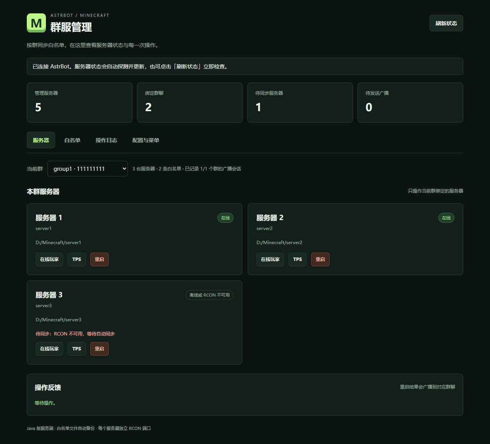
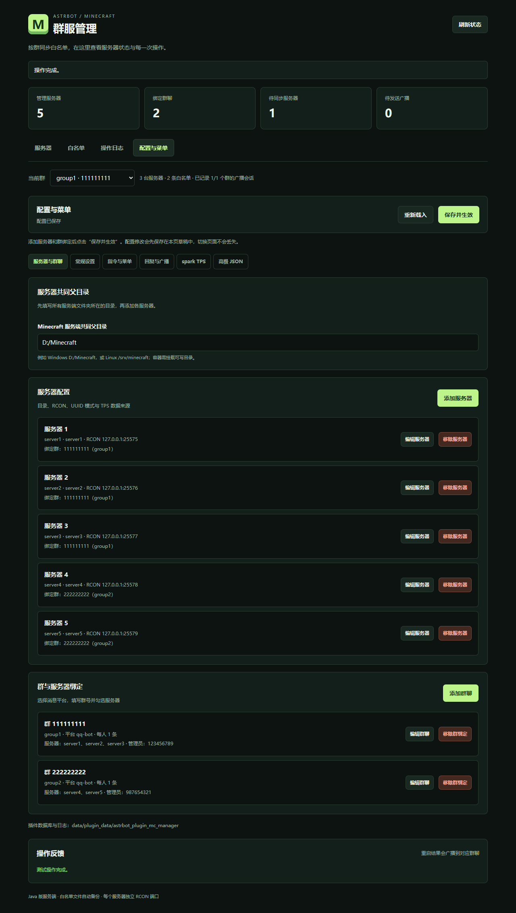
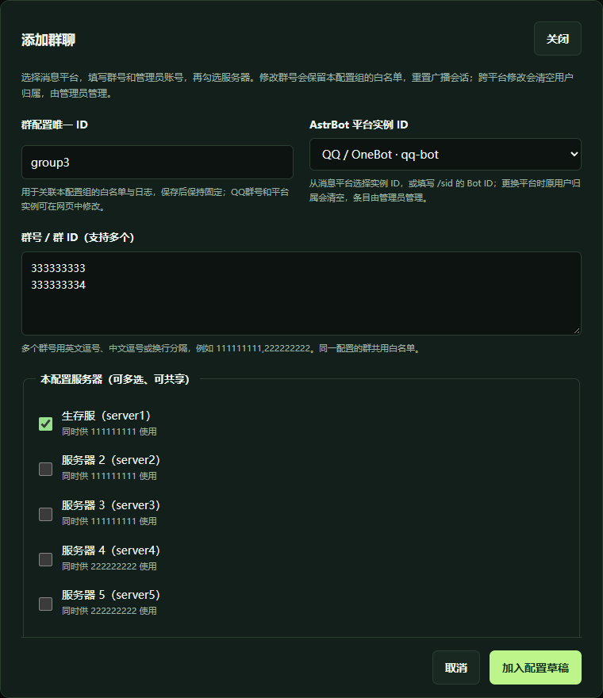
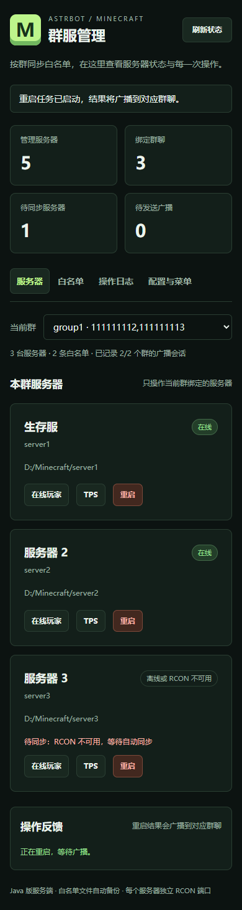
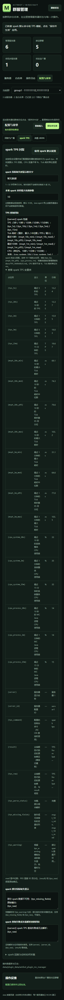
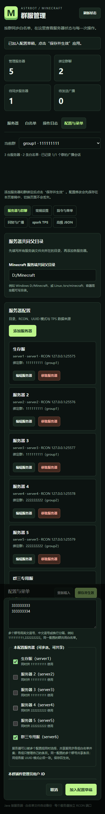
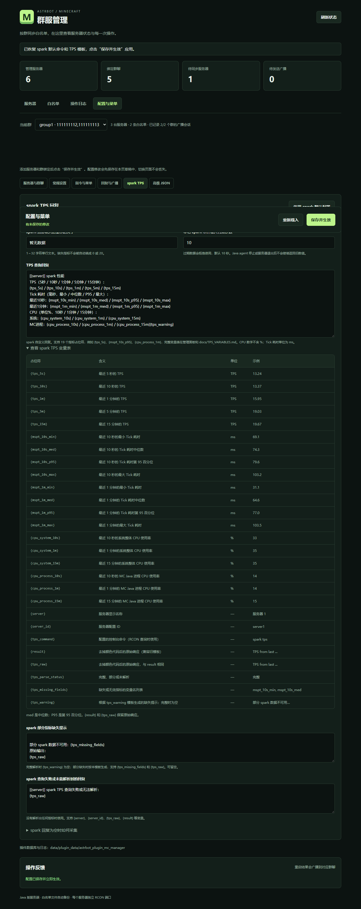

# 网页管理说明

入口：**AstrBot → 插件管理 → Minecraft 群服管理 → Minecraft 管理面板**。页面使用 AstrBot 后台身份认证。插件根目录的 `logo.png` 是插件图标。

## 服务器概览

选择群聊后显示该群绑定的服务器，可查询在线玩家、TPS 或发起重启。后台管理员拥有对应管理权限；页面新增白名单归属于 `dashboard:<后台用户名>`。

插件启动、重载、保存有效配置后立即后台并行探测全部服务器；首次完成前显示“探测中”。后续每轮按 `sync_interval`（默认 30 秒）重新探测，页面每 10 秒读取最新状态。页面隐藏、操作执行中或正在编辑配置时不会自动刷新概览。“刷新状态”会立即主动探测。

状态表示 RCON 可用性，不等同于游戏端口状态。单服连接缓慢不阻止其他服务器更新；白名单文件异常也不阻止探测。自动探测不会发送群广播。

## 添加服务器与群聊

在“配置与菜单 → 服务器与群聊”完成：

1. 设置服务端共同父目录。
2. 点击“添加服务器”，填写唯一 ID、名称、相对目录、RCON 地址/端口/密码与 UUID 模式，加入草稿。
3. 点击“添加群聊”，填写内部配置 ID，选择消息平台实例，填写一个或多个实际群号，支持逗号和换行。
4. 勾选允许该群管理的服务器，按需填写本群管理员和条目上限，加入草稿。
5. 点击“保存并生效”。

平台实例 ID 使用 `/sid` 返回的 Bot ID。没有可选平台时，应先在 AstrBot 配置消息平台；页面也允许按提示手动输入实例 ID。同一服务器可以被多个配置组重复选择，复选框不会因其他组已使用而禁用。同一配置可填写多个群号并共用白名单；分开的配置组仍各自管理条目，共享服取并集。同组各服必须使用相同 UUID 模式。

如果原生配置有空白或缺字段的群绑定，页面仍然可打开，并自动进入配置页。修正或删除空白项后保存即可启用服务；必要时可用高级 JSON 修复配置结构。

## 配置分类

| 页面 | 可以修改的内容 |
| --- | --- |
| 服务器与群聊 | 共同父目录、服务器、RCON、多群号、共享服务器、平台、管理员、每人条目上限 |
| 常规设置 | 在线探测与同步间隔、分页、RCON 超时、重启超时、检查间隔、游戏内广播 |
| 指令与菜单 | 主指令与子指令别名、`/mc` 帮助文本 |
| 回复与广播 | 白名单回复、列表格式、查询回复、日志格式、重启成功/失败与游戏广播 |
| spark TPS | 数据来源与查询命令、指标文件、有效期、模板、变量表、缺失文字 |
| 高级 JSON | 批量修改完整配置，与可视化表单同步 |

完整默认值见[默认配置](../config.default.json)，变量含义见 [TPS 变量表](TPS_VARIABLES.md)。

## 保存、密码与草稿

表单和弹窗编辑先进入草稿，未保存时显示“有未保存的修改”。切换群、功能页或刷新服务器状态不会覆盖草稿；关闭或刷新整个浏览器页面时会提示离开确认。

“保存并生效”应用草稿并重建后台服务，无需额外重载。通过 AstrBot 原生插件配置页修改后，需要重载插件。“重新载入”恢复后台保存的版本，有未保存草稿时会先确认。

高级 JSON 编辑后点击“应用到表单”，最终仍需保存。切回表单时会检查 JSON 格式。多个页面同时编辑时，旧版本保存会收到冲突提示，应重新载入最新配置后再修改。

已有 RCON 密码不会返回明文：密码留空表示保留；输入新值表示替换；显式勾选清除才会清除。高级 JSON 中 `__KEEP__` 同样表示保留，不能把它当成新增服务器的真实密码。环境变量名不是密码；填写后优先读取 AstrBot 进程的相应变量。

## 修改群号、释放与转移服务器

已保存的内部配置 ID 固定，实际群号与平台实例可以编辑。

| 操作 | 保存后的行为 |
| --- | --- |
| 同平台增减群号 | 保留白名单、编号、用户归属和仍有效的群会话；失效会话清理，待发通知重置 |
| 跨平台改绑 | 保留玩家条目和编号，清空旧用户归属，转由管理员管理 |
| 新增群号或修改平台 | 新群需要发送 `/mc` 记录会话；跨平台修改清理旧会话 |
| 删除配置或取消服务器勾选 | 移除该组关联，其他组继续使用共享服，原组数据归档保留 |
| 多组选择同一服务器 | 同步各组条目并集，不自动把其他组成员导入本组 |

服务器始终可被其他组选择，共享关系会显示在服务器卡片和选择列表中；**保存后才正式生效**。删除绑定但未重新分配的服务器，其现有白名单文件保持原状。若服务器只剩一个新组且该组为空，会同步空白名单；若仍由多组共享，则保留其他组的有效条目。

## 白名单、日志与重启

“白名单”页可添加、修改或移除当前群条目。“操作日志”可分页并按用户 ID 筛选。群成员自助操作通过聊天命令完成，权限说明见 [README](../README.md#权限规则)。

“导入现有条目”合并额外手工添加的磁盘条目，跳过其他配置组已托管的成员。“同步”用于立即重试当前数据库状态。重启会发送 `stop`，执行前应先配置自动启动脚本；流程见[部署指南](DEPLOY.md)。

查看手机布局和 spark 配置

截图来自浏览器测试中的模拟数据，用于展示布局；实际界面以所安装版本为准。
