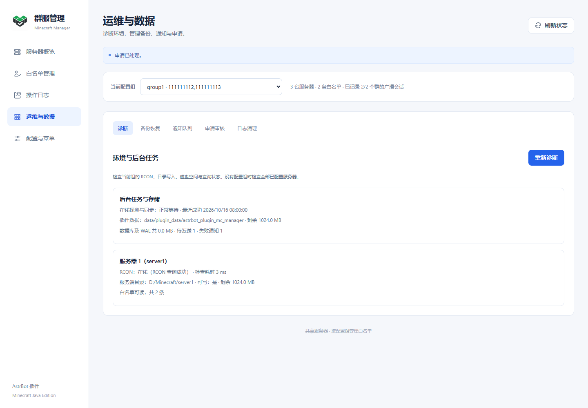
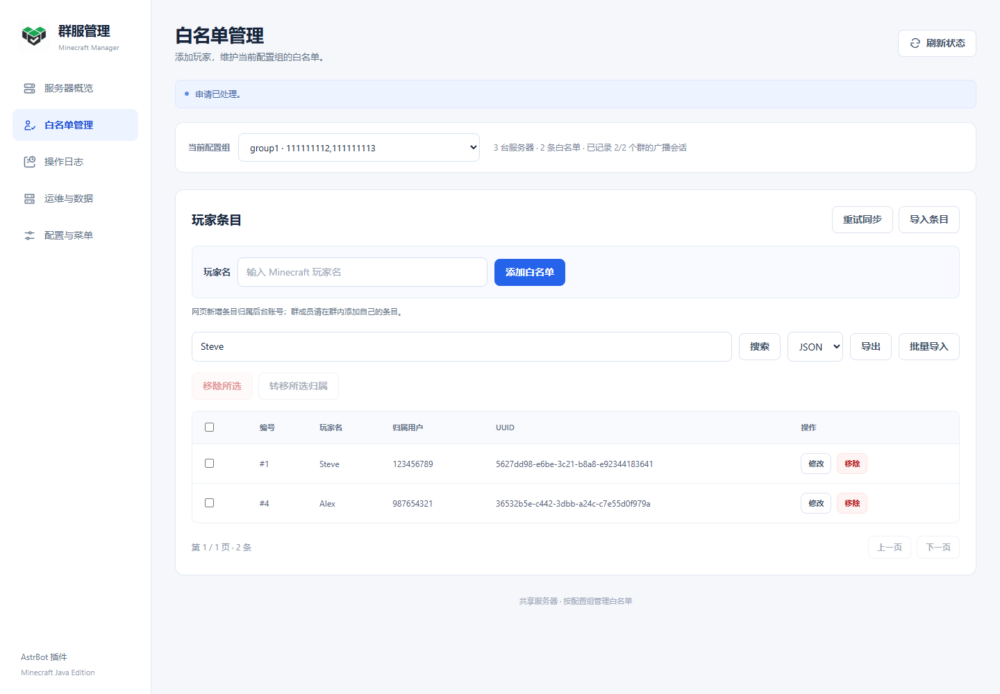
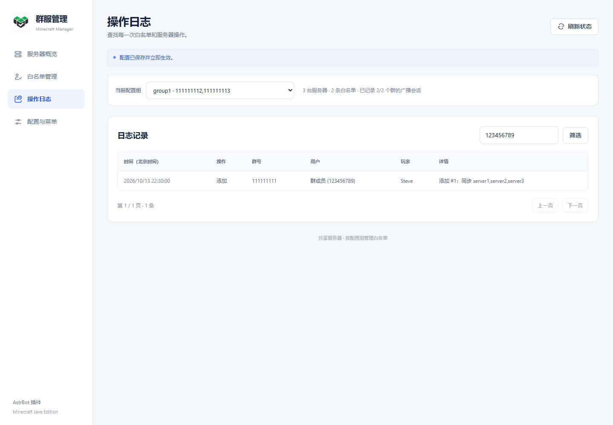
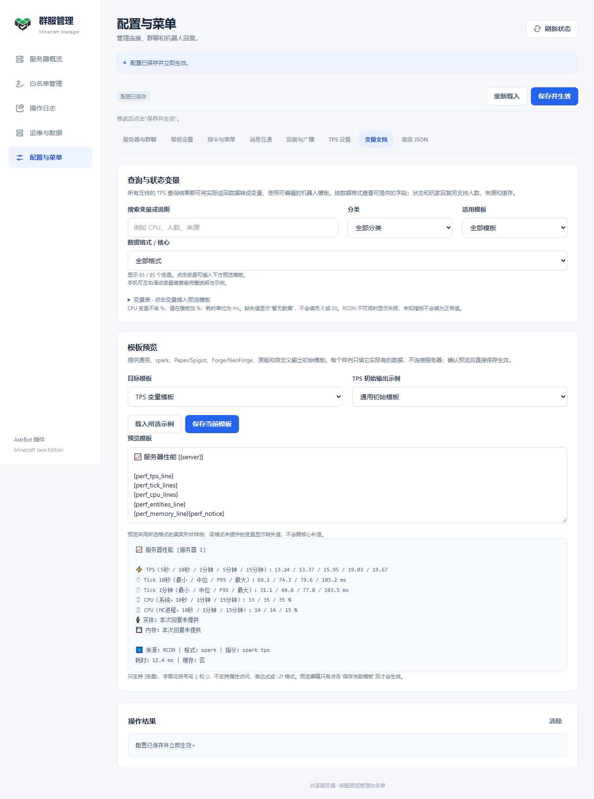
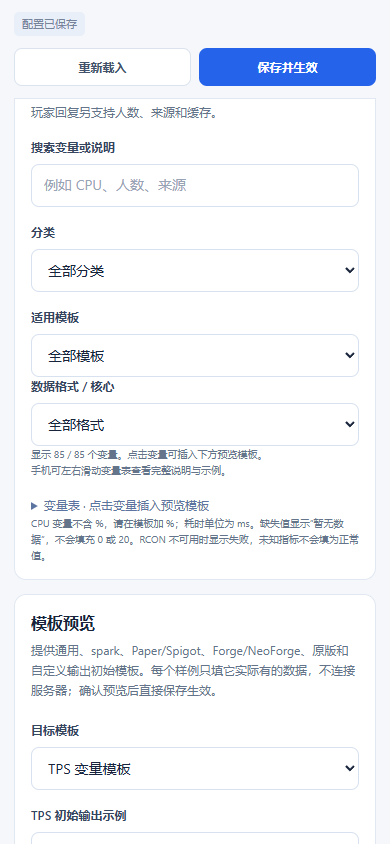

# 网页管理说明

入口：**AstrBot → 插件管理 → Minecraft 群服管理 → Minecraft 管理面板**。页面使用 AstrBot 后台身份认证。v1.4.0 采用蓝白简约界面：桌面左侧导航切换服务器概览、白名单管理、操作日志和配置与菜单，手机顶部使用紧凑导航。插件图标、页面标识和 favicon 均使用提供的 Logo，页面附带本地图片，无需访问外部图床。

首次安装或尚未绑定群聊时自动打开[快速配置](QUICK_START.md)。通常填写目录和群号即可扫描并一次保存；手动添加和高级选项保留在折叠区域。

## 服务器概览

概览顶部显示全部服务器、绑定群聊、待同步和待发广播数量。选择配置组后显示该组绑定的服务器，可查询在线玩家、TPS 或发起重启；“配置/修复连接”直接打开对应服务器编辑器；服务端目录默认折叠，可按需展开。查询结果显示在下方“操作结果”，可以清除，切换功能页或配置组时会自动收起。后台管理员拥有对应管理权限；页面新增白名单归属于 `dashboard:<后台用户名>`。

插件启动、重载、保存有效配置后立即后台并行探测全部服务器；首次完成前显示“探测中”。后续每轮按 `sync_interval`（默认 30 秒）重新探测，页面每 10 秒读取最新状态。页面隐藏、操作执行中或正在编辑配置时不会自动刷新概览。“刷新状态”会立即主动探测。

状态表示 RCON 可用性，不等同于游戏端口状态。单服连接缓慢不阻止其他服务器更新；白名单文件异常也不阻止探测。自动探测不会发送群广播。

## 运维与数据、批量管理

新增“运维与数据”导航，包含诊断、备份恢复、通知队列、申请审核和日志清理。白名单页增加搜索、分页、批量导入预览、移除、转移归属及导出；日志页增加玩家、动作、日期筛选和导出。配置中的运维参数仍在常规设置修改。

具体操作、权限和备份限制见[运维说明](OPERATIONS.md)。

## 添加服务器与群聊

配置页为全局设置，不显示当前配置组选择器。默认展示“快速配置”：

1. 填写共同父目录或单台服务端目录、群号；只有一个机器人时自动选择。
2. 扫描 `server.properties`，核对服务器列表和需要处理的提示，勾选要关联的服务器。
3. 点击“保存并完成配置”，一次添加服务器和群绑定，并进入对应组概览。

密码由后台读取，扫描响应、页面和保存请求不包含读取到的明文密码。扫描结果绑定当前后台账号、配置修订版本和文件指纹，10 分钟后失效；文件或配置变化后需重新扫描。失败的保存可在条件未改变时重试，仍使用既有原子保存和回滚机制。

需要逐项编辑时展开“手动配置”。内部 ID、默认端口和唯一服务器勾选自动生成；手动弹窗可先运行只读连接测试，再保存或取消。

平台实例 ID 使用 `/sid` 返回的 Bot ID。没有可选平台时，应先在 AstrBot 配置消息平台；页面也允许按提示手动输入实例 ID。同一服务器可以被多个配置组重复选择，复选框不会因其他组已使用而禁用。同一配置可填写多个群号并共用白名单；分开的配置组仍各自管理条目，共享服取并集。同组各服必须使用相同 UUID 模式。

如果原生配置有空白或缺字段的群绑定，页面仍然可打开，并自动进入配置页。修正或删除空白项后保存即可启用服务；必要时可用高级 JSON 修复配置结构。

## 配置分类

| 页面 | 可以修改的内容 |
| --- | --- |
| 服务器与群聊 | 共同父目录、服务器、RCON、多群号、共享服务器、平台、管理员、每人条目上限 |
| 常规设置 | 在线探测与同步间隔、分页、RCON 超时、重启超时、检查间隔、游戏内广播 |
| 指令与菜单 | 主指令与子指令别名、`/mc` 帮助文本 |
| 回复与广播 | 白名单回复、列表格式、查询回复、日志格式、重启成功/失败与游戏广播 |
| TPS 设置 | 按服填写查询指令，选择模板/原文，设置自动探测与 spark 日志回读 |
| 变量文档 | 搜索/分类/按模板筛选查询变量，点击插入、示例预览与直接保存 |
| 高级 JSON | 批量修改完整配置，与可视化表单同步 |

完整默认值见[默认配置](../config.default.json)，变量含义见 [TPS 变量表](TPS_VARIABLES.md)。

## TPS 查询设置

“TPS 设置”按服务器显示查询指令、回复方式与可选的指令自动探测。直接填写 spark tps、tps、forge tps、tick query 或其他有效的自定义指令，插件按实际返回内容识别数据，无需再选择 spark/原生模式。模板与原文回复均可使用。

查询统一通过 RCON 发送。spark 报告只写控制台时，可展开本服“新增日志回读”配置路径、编码、等待时间和开关；仅在实际命令为 spark tps 时启用。无需 Java 采集器。下方“恢复初始模板”只恢复机器人 TPS 回复文案，不修改任何服务器查询指令。旧 native 未填写指令时自动补为 tps，旧 spark/无类型配置补为 spark tps，已有自定义指令保持原样。

字段、完整输出与分段规则见 [TPS 说明](TPS_VARIABLES.md#查询方式与可提供的数据)。

## 保存与密码

普通设置修改后点击顶部“保存并生效”。服务器和群聊弹窗只提供保存与取消，不再有暂存入口；取消不保留本次弹窗修改，保存失败时留在表单中显示错误，可修正后重试。模板预览通过“保存当前模板”直接生效。

成功保存会重建后台服务，无需额外重载。通过 AstrBot 原生插件配置页修改后需要重载插件。“重新载入”读取后台保存的版本，存在未保存输入时会先确认。成功保存后的页面刷新失败会明确提示“配置已保存”，不会被当成保存失败；重新载入后继续编辑。

高级 JSON 可以直接保存，也可以先点击“预览到表单”。切回表单时会检查 JSON 格式。多个页面同时编辑时，旧版本保存会收到冲突提示，应重新载入最新配置后再修改。

已有 RCON 密码不会返回明文：密码留空表示保留；输入新值表示替换；显式勾选清除才会清除。高级 JSON 中 `__KEEP__` 同样表示保留，不能把它当成新增服务器的真实密码。环境变量名不是密码；填写后优先读取 AstrBot 进程的相应变量。

## 修改群号、释放与转移服务器

已保存的内部配置 ID 固定，实际群号与平台实例可以编辑。

| 操作 | 保存后的行为 |
| --- | --- |
| 同平台增减群号 | 保留白名单、编号、用户归属和仍有效的群会话；失效会话清理，待发通知重置 |
| 跨平台改绑 | 保留玩家条目和编号，清空旧用户归属，转由管理员管理 |
| 新增群号或修改平台 | 新群需要发送 `/mc` 记录会话；跨平台修改清理旧会话 |
| 删除配置或取消服务器勾选 | 移除该组关联，其他组继续使用共享服，原组数据归档保留 |
| 多组选择同一服务器 | 同步各组条目并集，不自动把其他组成员导入本组 |

移除服务器时会一次确认所有受影响的群绑定；自动解绑，只有该服务器的组一并移除绑定，并立即保存，服务端文件与历史数据保留。

服务器始终可被其他组选择，共享关系会显示在服务器卡片和选择列表中；**保存后才正式生效**。删除绑定但未重新分配的服务器，其现有白名单文件保持原状。若服务器只剩一个新组且该组为空，会同步空白名单；若仍由多组共享，则保留其他组的有效条目。

## 白名单、日志与重启

“白名单管理”显示当前配置组的玩家条目、固定编号、归属用户和 UUID，可添加、修改或移除；窄屏表格可在表格区域横向滚动。“操作日志”可分页并按用户 ID 筛选，显示群、操作者、动作和玩家信息。群成员自助操作通过聊天命令完成，权限说明见 [README](../README.md#权限规则)。

“导入现有条目”合并额外手工添加的磁盘条目，跳过其他配置组已托管的成员。“同步”用于立即重试当前数据库状态。重启会发送 `stop`，执行前应先配置自动启动脚本；流程见[部署指南](DEPLOY.md)。

查看手机布局和 spark 配置

截图来自浏览器测试中的模拟数据，用于展示布局；实际界面以所安装版本为准。

## 消息互通（可选）

在网页“配置与菜单 → 消息互通”同时开启总开关和目标群开关，可设置两个转发方向、聊天/进退服/死亡事件、转发前缀和模板。服务器编辑窗口可设置本服内日志路径与编码；Docker 需挂载日志目录。群 → 游戏依赖 RCON，游戏 → 群读取新增日志，无需额外消息推送模组。详见[消息互通说明与变量表](MESSAGE_BRIDGE.md)。

## 白名单直接覆盖

在“配置与菜单 → 服务器与群聊 → 编辑服务器”中设置“允许直接覆盖白名单文件”，默认关闭，按服务器独立保存。开启后可备份并重建异常文件；备份失败仍停止写入。已有的待同步条目可在保存后自动重试，或由管理员发送 `/mc 同步`。具体恢复边界见[配置说明](CONFIGURATION.md#白名单直接覆盖开关)。

## 查询与变量文档

“TPS 设置”中可开启“TPS 指令自动探测”，默认关闭；成功指令缓存时长和查询总超时在“常规设置”修改。服务器概览显示实际状态查询命令、耗时及可解析的人数，指令异常或探测总超时单独显示，不冒充查询成功。

“变量文档”独立于 spark 编辑区域，不同查询指令下都可查状态/玩家变量。可按 TPS、Tick、CPU、查询信息、服务器状态与辅助变量分类，并按适用模板筛选；点击变量插入下方编辑框。“使用精简示例”载入对应模板样例，“保存当前模板”直接写入所选模板并生效。预览只渲染文档数据，不查询服务器、不执行输入的 HTML。

## 保存时空间不足

页面会显示“写入位置可用空间不足”或“存储配额已用尽”，保留当前输入供修正后重试。先在运行 AstrBot 的服务器释放配置目录所在盘的空间/调整配额，再重试。首次原子写入失败不会切换实例或重复写盘回滚；若配置已经写入但服务切换未完成，或旧配置回写也失败，会单独说明并提示重载核对。详见[存储故障排查](DEPLOY.md#配置保存提示磁盘空间不足)。

## spark 控制台报告回读

“TPS 设置”的每台服务器下都有“spark 无回复时：新增日志回读”。默认读取服务端日志 logs/latest.log 的本次新增内容，可关闭，或调整编码与等待秒数。成功时来源变量显示“服务端新增日志”。不会因控制台历史中有旧报告就当作本次成功；Docker 或远程文件部署需确保 AstrBot 能读取当前日志。详见[查询说明](TPS_VARIABLES.md#控制台有报告但-rcon-返回空响应)。

## 按核心选择变量和初始回复

变量文档新增数据格式/核心筛选，85 个字段逐项标明含义、单位、可能来源和示例。预览可选择通用、spark、Paper/Spigot、Forge/NeoForge、原版 tick query、自定义回复 6 套初始文本，预览只填这一格式的实际样例值。点击“保存当前模板”更新 messages.tps 并生效。模板只是起点，可以自由删除标签、改文字或单独使用数值变量，详见[示例文档](TPS_TEMPLATES.md)。

变量表默认折叠，方便先看到初始模板；搜索或选择分类/格式时自动展开对应结果，手机仍可横向查看说明。

## 全部消息模板

“配置与菜单 → 回复与广播”列出全部插件消息，包含嵌套的同步行、TPS 标签、权限/配置错误、日志详情和游戏广播。默认显示常用回复，分类可选择“全部分类”，也可搜索原文、messages 键名或变量。每项显示变量说明，点击变量可插入光标处，“恢复此项默认”只修改这一项当前输入，保存后生效。

帮助、TPS 和互通页的专用编辑器与这里同步显示当前输入。完整回复留空时不发送，内部模板留空隐藏对应片段；操作仍执行。变量和外部数据只替换一次，不执行表达式。详细默认值、变量及队列/旧日志边界见[全部消息模板](MESSAGES.md)。

页面示例：[桌面消息编辑器](screenshots/message-settings.png) · [手机消息编辑器](screenshots/message-settings-mobile.png)。

## 常用选项优先

常规参数与指令页默认只展示常用字段，其他选项在“更多设置/更多指令别名”。服务器和群聊表单的内部标识、连接细节与权限细分在“更多选项”；填写错误时会展开相关区域。TPS 输入框可点击常用指令按钮填入，只改变这一项指令。

“回复与广播”每次先显示 8 个匹配模板，可搜索或点击“显示更多模板”。“变量文档”选择初始输出样例后可预览并直接“保存当前模板”，不再提供暂存按钮。旧自定义文字不会被替换；精简菜单对应 help，完整菜单对应 help_full。
